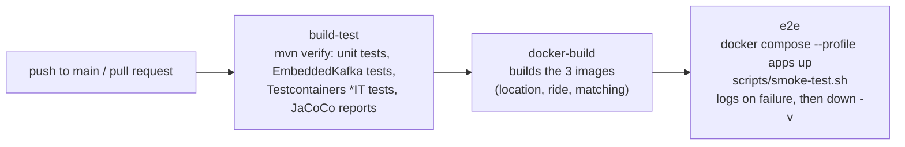

# rideflow-microservices

An Uber-like ride-hailing backend built with event-driven Spring Boot microservices.


[](https://github.com/<your-username>/rideflow-microservices/actions/workflows/ci.yml)

**Status: under active development**

## Services

| Service            | Port | Responsibility |
|--------------------|------|----------------|
| location-service   | 8082 | Tracks driver locations and answers nearby-driver queries (Redis Geo) |
| ride-service       | 8083 | Ride lifecycle: request, persistence, status updates (MySQL) |
| matching-service   | 8084 | Consumes ride requests and matches them with nearby drivers |

## Architecture

## Tech Stack

- Java 17
- Spring Boot 3.x
- Spring Kafka
- Spring Data Redis (Geo)
- Spring Data JPA + MySQL
- OpenFeign
- Maven, Lombok

## Project structure

```
rideflow-microservices/
├── pom.xml                  # parent POM (rideflow-parent)
├── docker-compose.yml       # infra definition (Redis, MySQL, Kafka)
├── .env.example
├── docs/
├── libs/
│   └── common-events/       # shared Kafka event DTOs and topic names
└── services/
    ├── location-service/
    ├── ride-service/
    └── matching-service/
```

## Concurrency

Many ride requests are matched at the same time, and two of them must never get the same driver. Matching therefore asks location-service to *reserve* a driver instead of just reading the nearby list. The check and the write happen inside one Redis Lua script (`reserve_driver.lua`), which Redis runs atomically, so concurrent requests cannot both see a driver as free. The script is idempotent per ride (a redelivered `ride.requested` gets the same driver), reserved drivers are hidden from nearby searches, and the reservation is released when ride-service publishes `ride.closed`. A TTL (`location.reservation-ttl-seconds`, 30 min) frees the driver anyway if a ride is never closed. See [docs/api/location-service.md](docs/api/location-service.md).

## Run the full stack

For people **with Docker** (local Docker is optional: CI builds the images and runs the whole stack for you, see below):

```bash
cp .env.example .env          # replace the placeholder passwords for anything but a throwaway local run
docker compose --profile apps up --build
```

A plain `docker compose up` still starts only the infrastructure (Redis, MySQL, Kafka). The `apps` profile adds the three services, which
wait for their dependencies to be healthy (matching-service also waits for location-service). Inside the containers the services use the
container hostnames (`redis`, `mysql`, `kafka:29092`, `location-service`), so the `localhost` values in `.env` only matter when you run a
service from your IDE.

| What | URL |
|------|-----|
| location-service Swagger UI | http://localhost:8082/swagger-ui.html |
| ride-service Swagger UI | http://localhost:8083/swagger-ui.html |
| matching-service Swagger UI | http://localhost:8084/swagger-ui.html |

With the stack up, `bash scripts/smoke-test.sh` runs the end-to-end check (needs `curl` and `jq`). Stop everything with
`docker compose --profile apps down -v`.

## CI pipeline

GitHub Actions ([.github/workflows/ci.yml](.github/workflows/ci.yml)) runs on every push to `main` and on pull requests; a newer push cancels the
older run of the same branch. Dependabot proposes weekly updates for Maven, GitHub Actions and the Dockerfiles.



| Job | What it proves |
|-----|----------------|
| `build-test` | The code compiles and all tests pass, including the Redis Lua-script tests that need Docker. Test and coverage reports are uploaded as an artifact and a coverage table goes into the job summary. |
| `docker-build` | Each Dockerfile builds (nothing is pushed). |
| `e2e` | The containers start, become healthy and complete a ride (register drivers, request, match, cancel, release). |

You do not need Docker on your machine to contribute: open a pull request and CI covers the Docker parts.

## API documentation

Every service serves interactive OpenAPI docs (springdoc). Start the stack, then open:

| Service | Swagger UI | OpenAPI JSON |
|---------|------------|--------------|
| location-service | http://localhost:8082/swagger-ui.html | http://localhost:8082/v3/api-docs |
| ride-service | http://localhost:8083/swagger-ui.html | http://localhost:8083/v3/api-docs |
| matching-service | http://localhost:8084/swagger-ui.html | http://localhost:8084/v3/api-docs |

The generated docs are the **source of truth** for request/response shapes and status codes; the Markdown files in
[docs/api](docs/api) add background (flows, Kafka events, failure handling). Set `SWAGGER_ENABLED=false` to switch the UI off (for example in production).

### Postman

1. In Postman choose **Import** and select both files from [docs/postman](docs/postman):
   `rideflow.postman_collection.json` and `rideflow.postman_environment.json`.
2. Select the **Rideflow local** environment (ports 8082, 8083, 8084).
3. Run single requests, or run the folder **Happy path (run in order)** with the Collection Runner: it registers 3 drivers, requests a ride, waits for
   `ACCEPTED`, cancels it and checks the driver comes back (the same scenario as `scripts/smoke-test.sh`).

Requests carry test scripts (status codes) and save `{{rideId}}` after "Request ride"; the Idempotency-Key is generated with `{{$guid}}`.

### Endpoint overview

**location-service** (`/api/v1/locations`)

| Method | Path | Purpose |
|--------|------|---------|
| POST | `/drivers/update` | Create or refresh a driver's position and heartbeat |
| GET | `/drivers/nearby` | Online, unreserved drivers within a radius, nearest first |
| POST | `/drivers/reserve` | Atomically reserve the first free candidate driver for a ride (409 if none) |
| DELETE | `/reservations/{rideId}` | Release the driver held for a ride |
| DELETE | `/drivers/{driverId}` | Remove a driver |

**ride-service** (`/api/v1/rides`)

| Method | Path | Purpose |
|--------|------|---------|
| POST | `/request` | Request a ride (`Idempotency-Key` header: 201 first time, 200 on replay; 409 if the rider has an active ride) |
| GET | `/{rideId}` | Ride details |
| GET | `/{rideId}/status` | Lightweight status for polling |
| GET | `/rider/{riderId}` | A rider's rides, newest first |
| PUT | `/{rideId}/start` | Start the ride |
| PUT | `/{rideId}/complete` | Complete the ride |
| PUT | `/{rideId}/cancel` | Cancel the ride |

**matching-service** has no business REST API (it works on Kafka events); only `GET /actuator/health` and `GET /actuator/info`.

## Reliability

- **Idempotent requests:** `POST /api/v1/rides/request` accepts an `Idempotency-Key` header. A repeated key returns the same ride (`200` instead of `201`), enforced by a unique `(rider, key)` constraint even for simultaneous duplicates. A rider can have only one active ride.
- **Atomic driver reservation:** a driver is reserved with one Redis Lua script, so two rides never get the same driver. The reservation is released by the `ride.closed` event and expires on its own as a safety net.
- **Retries + DLT:** a ride that finds no driver is retried up to 3 times by a scheduler (which also recovers lost Kafka messages). Failing Kafka records are retried 3 times, then sent to a `.DLT` topic.
- **Transactional publishing:** Kafka events are sent only after the database transaction commits, so a rolled-back request publishes nothing.
- **Optimistic locking:** rides carry a `@Version`, so concurrent updates (cancel vs match, two scheduler instances) never overwrite each other; the loser retries or backs off.

Details: [ride-service](docs/api/ride-service.md), [location-service](docs/api/location-service.md), [matching-service](docs/api/matching-service.md).

## Roadmap

- [x] 1. Repository skeleton
- [x] 2. Shared events module
- [x] 3. location-service
- [x] 4. ride-service core
- [x] 5. Kafka producer
- [x] 6. matching-service
- [x] 7. ride-service consumer
- [x] 8. Reliability
  - [x] 8A. Driver reservation (atomic Lua script, `ride.closed` release)
  - [x] 8B. Idempotent requests, retries and ride closing (ride-service)
- [x] 9. Tests
- [x] 10. API docs
- [x] 11. Docker + CI
- [ ] 12. Final docs

## License

Released under the [MIT License](LICENSE).
