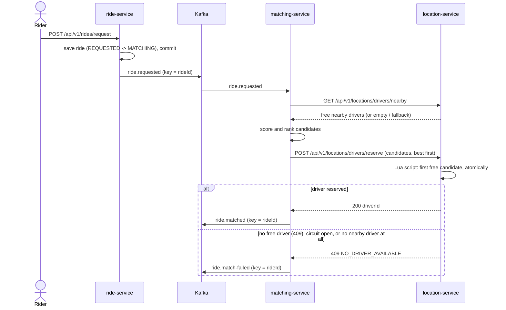

# matching-service

Port `8084`. Event-driven only: it has no REST API of its own (just the actuator `health` and `info` endpoints). It consumes `ride.requested`, asks location-service for nearby free drivers, ranks them, reserves one and publishes the result.

## Flow



## Consumed: `ride.requested`

Group `matching-service-group`, offsets committed after each record.

```json
{
  "rideId": "7c9e6679-7425-40de-944b-e07fc1f90ae7",
  "riderId": "rider-42",
  "pickupLatitude": 12.9716,
  "pickupLongitude": 77.5946,
  "pickupAddress": "MG Road",
  "dropLatitude": 13.0827,
  "dropLongitude": 80.2707,
  "dropAddress": "T Nagar",
  "requestedAt": "2026-01-01T10:00:00Z"
}
```

## Produced

Both topics use `rideId` as the message key.

### `ride.matched`

```json
{
  "rideId": "7c9e6679-7425-40de-944b-e07fc1f90ae7",
  "riderId": "rider-42",
  "driverId": "driver-7",
  "driverLatitude": 12.9741,
  "driverLongitude": 77.5968,
  "distanceToPickupKm": 0.42,
  "matchedAt": "2026-01-01T10:00:01Z"
}
```

### `ride.match-failed`

```json
{
  "rideId": "7c9e6679-7425-40de-944b-e07fc1f90ae7",
  "riderId": "rider-42",
  "reason": "NO_DRIVERS_AVAILABLE",
  "failedAt": "2026-01-01T10:00:01Z"
}
```

## Scoring

```
score = wDistance * (1 - min(distanceKm / radiusKm, 1)) + wRating * (rating / 5.0)
```

| Setting | Default |
|---------|---------|
| `matching.search-radius-km` | `5.0` |
| `matching.max-candidates` | `10` |
| `matching.weights.distance` | `0.7` |
| `matching.weights.rating` | `0.3` |

The two weights must sum to `1.0`, otherwise the service refuses to start. The highest score wins; ties go to the smaller distance, then to the alphabetically smaller `driverId`, so the same input always gives the same driver.

Ratings come from `DriverRatingProvider`. Until a driver-service exists, `StaticDriverRatingProvider` returns `4.5` for every driver, so ranking is effectively by distance.

## Driver reservation

After scoring, all candidates (best first, at most 20) go to location-service's `POST /api/v1/locations/drivers/reserve`. The driver it returns is the match, even if it is not the top-scored one because another ride reserved that driver in between. location-service decides in one atomic Lua script, so a driver can never be matched to two rides, and a repeated request for the same ride returns the same driver. `ride.matched` carries that driver's location and distance taken from the candidate list.

A `409` (every candidate taken) or the circuit-breaker fallback means no match: `ride.match-failed` is published. The 409 is ignored by the circuit breaker's failure count because it is a normal answer, not an outage.

Known limitation: reserved drivers are hidden from `/drivers/nearby`. If `ride.requested` is redelivered after a successful match and no *other* free driver is nearby, the nearby list is empty and the ride is reported as failed instead of re-using its driver. If other free drivers are nearby, the reservation returns the original driver (location and distance are then `null` in `ride.matched`). Step 8B's ride-service must therefore ignore events for rides that already left `MATCHING`.

## Failure handling

- **location-service down or slow:** 2s connect and read timeouts, behind a Resilience4j circuit breaker. The fallback logs a warning and returns no drivers, so the ride is reported as `NO_DRIVERS_AVAILABLE`.
- **Processing error:** the record is retried 3 times, 1s apart, then published to `ride.requested.DLT` (3 partitions).
- **Undeserializable message:** goes straight to `ride.requested.DLT` without retries.
- **Reserve call times out after succeeding:** the driver stays reserved while the ride is reported as failed; it is freed by the `ride.closed` event, or at the latest by the reservation TTL.
- **Publish failure:** logged with the `rideId`; there is no retry yet (Step 8).
