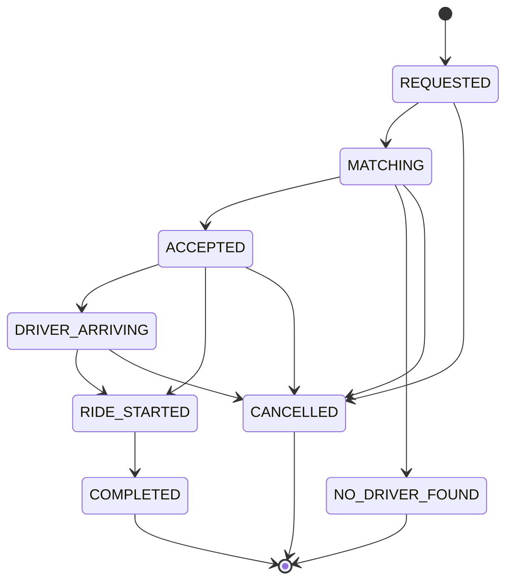

# ride-service API

Base URL: `http://localhost:8083/api/v1/rides`

Ride ids are UUID strings. Fares are decimals with two places: `50 + 12 per km` (straight-line distance),
minimum `60.00`.

## Status lifecycle



`COMPLETED`, `CANCELLED` and `NO_DRIVER_FOUND` are terminal. A new ride is saved as `REQUESTED` and moved to
`MATCHING` in the same transaction. `ACCEPTED` and `NO_DRIVER_FOUND` are set by the matching flow (added in a
later step), not by an endpoint. Any disallowed move returns `409 Conflict`.

## POST /request

Create a ride. Returns `201 Created`.

```bash
curl -X POST http://localhost:8083/api/v1/rides/request \
  -H "Content-Type: application/json" \
  -d '{
    "riderId": "rider-1",
    "pickupLatitude": 12.9716, "pickupLongitude": 77.5946, "pickupAddress": "MG Road",
    "dropLatitude": 13.1986, "dropLongitude": 77.7066, "dropAddress": "Airport"
  }'
```

```json
{
  "id": "7c9e6679-7425-40de-944b-e07fc1f90ae7",
  "riderId": "rider-1",
  "driverId": null,
  "pickupLatitude": 12.9716,
  "pickupLongitude": 77.5946,
  "pickupAddress": "MG Road",
  "dropLatitude": 13.1986,
  "dropLongitude": 77.7066,
  "dropAddress": "Airport",
  "status": "MATCHING",
  "estimatedFare": 386.06,
  "actualFare": null,
  "createdAt": "2026-01-01T10:00:00.123Z",
  "updatedAt": "2026-01-01T10:00:00.150Z",
  "startedAt": null,
  "completedAt": null,
  "version": 1
}
```

Errors: `400` with a field -> message map (invalid or missing fields), or `{"error": "..."}` when pickup and
drop are identical.

```json
{"riderId": "riderId must not be blank", "pickupLatitude": "pickupLatitude must be <= 90"}
```

## GET /{rideId}

```bash
curl http://localhost:8083/api/v1/rides/7c9e6679-7425-40de-944b-e07fc1f90ae7
```

`200` with the ride (same shape as above), or `404`:

```json
{"error": "Ride not found: 7c9e6679-7425-40de-944b-e07fc1f90ae7"}
```

## GET /rider/{riderId}

A rider's rides, newest first. `200` with a JSON array (empty if none).

```bash
curl http://localhost:8083/api/v1/rides/rider/rider-1
```

## PUT /{rideId}/start

Requires an assigned driver and status `ACCEPTED` or `DRIVER_ARRIVING`. Sets `startedAt`.

```bash
curl -X PUT http://localhost:8083/api/v1/rides/7c9e6679-7425-40de-944b-e07fc1f90ae7/start
```

## PUT /{rideId}/complete

Requires status `RIDE_STARTED`. Sets `completedAt` and `actualFare` (equal to `estimatedFare`).

```bash
curl -X PUT http://localhost:8083/api/v1/rides/7c9e6679-7425-40de-944b-e07fc1f90ae7/complete
```

## PUT /{rideId}/cancel

Allowed from `REQUESTED`, `MATCHING`, `ACCEPTED` and `DRIVER_ARRIVING`.

```bash
curl -X PUT http://localhost:8083/api/v1/rides/7c9e6679-7425-40de-944b-e07fc1f90ae7/cancel
```

## Errors

| Status | When |
|--------|------|
| 400 | Validation failure, malformed body, identical pickup/drop |
| 404 | Unknown ride id |
| 409 | Disallowed status transition, starting without a driver, or a concurrent update (optimistic lock) |
| 500 | Unexpected failure; body is `{"error": "Internal server error"}` with no stack trace |

State-change endpoints return `409` with `{"error": "Ride <id> cannot move from CANCELLED to RIDE_STARTED"}`.
