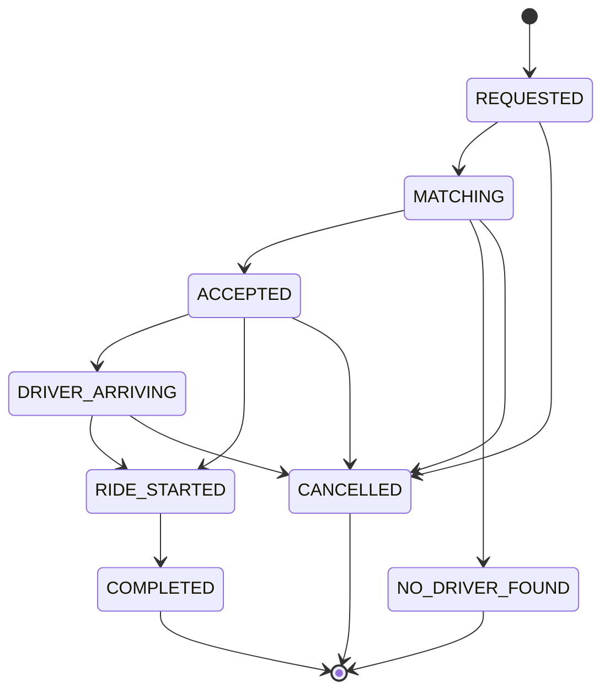
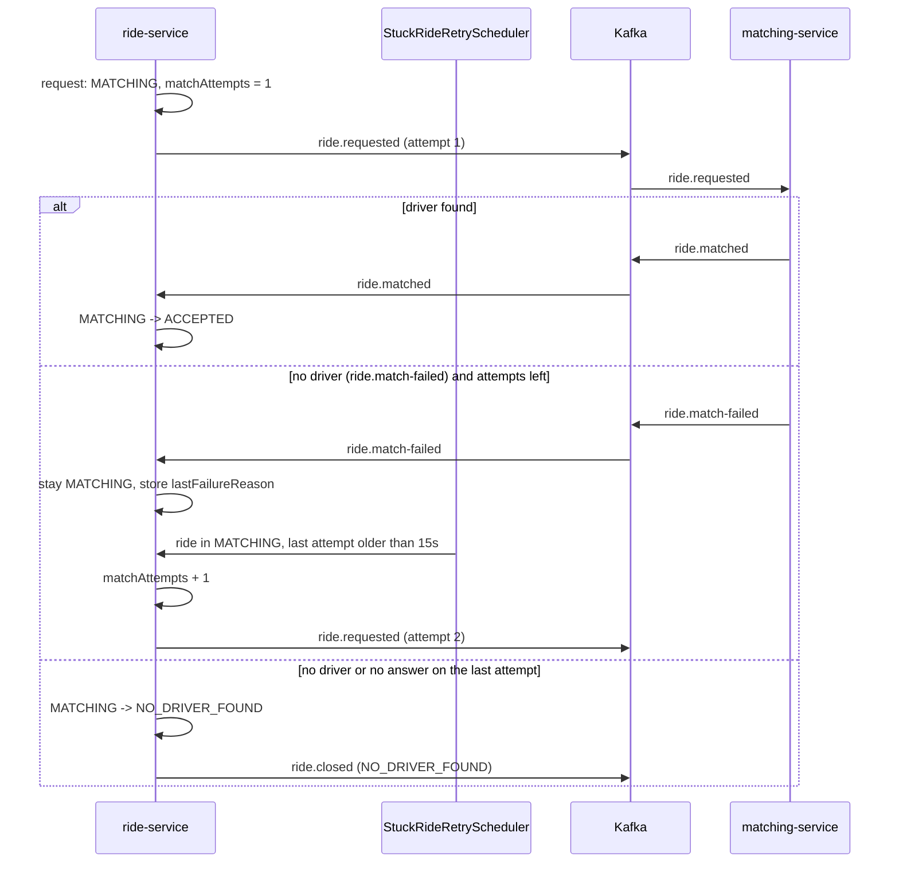

# ride-service API

> **Source of truth:** the generated OpenAPI docs, at http://localhost:8083/swagger-ui.html (JSON: `/v3/api-docs`). This page adds background and examples and may lag behind. A Postman collection is in [docs/postman](../postman).

Base URL: `http://localhost:8083/api/v1/rides`

Ride ids are UUID strings. Fares are decimals with two places: `50 + 12 per km` (straight-line distance),
minimum `60.00`.

## Status lifecycle



`COMPLETED`, `CANCELLED` and `NO_DRIVER_FOUND` are terminal. A new ride is saved as `REQUESTED` and moved to
`MATCHING` in the same transaction. `ACCEPTED` and `NO_DRIVER_FOUND` are set by the matching flow, not by an
endpoint; `NO_DRIVER_FOUND` only after all match attempts failed (see [Match retry policy](#match-retry-policy)).
Any disallowed move returns `409 Conflict`. Every move into a terminal state publishes a
[`ride.closed`](#rideclosed) event.

## POST /request

Create a ride. Returns `201 Created`, or `200 OK` when the request is a replay (see below).

| Header | Required | Constraint |
|--------|----------|------------|
| `Idempotency-Key` | no | at most 64 characters; a blank value counts as absent |

```bash
curl -X POST http://localhost:8083/api/v1/rides/request \
  -H "Content-Type: application/json" \
  -H "Idempotency-Key: 5f0c8e1a-2b7d-4c1e-9a3f-1d2e3f4a5b6c" \
  -d '{
    "riderId": "rider-1",
    "pickupLatitude": 12.9716, "pickupLongitude": 77.5946, "pickupAddress": "MG Road",
    "dropLatitude": 13.1986, "dropLongitude": 77.7066, "dropAddress": "Airport"
  }'
```

```json
{
  "id": "7c9e6679-7425-40de-944b-e07fc1f90ae7",
  "riderId": "rider-1",
  "driverId": null,
  "pickupLatitude": 12.9716,
  "pickupLongitude": 77.5946,
  "pickupAddress": "MG Road",
  "dropLatitude": 13.1986,
  "dropLongitude": 77.7066,
  "dropAddress": "Airport",
  "status": "MATCHING",
  "estimatedFare": 386.06,
  "actualFare": null,
  "createdAt": "2026-01-01T10:00:00.123Z",
  "updatedAt": "2026-01-01T10:00:00.150Z",
  "startedAt": null,
  "completedAt": null,
  "version": 1
}
```

### Idempotency: 201 vs 200

Send the same `Idempotency-Key` again (same `riderId`) after a timeout or a double tap and you get the **same ride**
back with `200 OK` instead of a second ride; the first call returned `201 Created`. The key is scoped to the rider:
another rider may use the same key. The request body of a replay is not compared, the stored ride is returned as is.

Two identical requests arriving at the same moment are safe too: a unique constraint on `(rider_id, idempotency_key)`
lets only one insert win, and the loser answers with the winner's ride (`200`).

### One active ride per rider

A rider with a ride in `REQUESTED`, `MATCHING`, `ACCEPTED`, `DRIVER_ARRIVING` or `RIDE_STARTED` cannot request
another. Response `409 Conflict`, with the id of the existing ride:

```json
{
  "error": "ACTIVE_RIDE_EXISTS",
  "message": "Rider rider-1 already has an active ride: 7c9e6679-7425-40de-944b-e07fc1f90ae7",
  "rideId": "7c9e6679-7425-40de-944b-e07fc1f90ae7"
}
```

The rider can request again once that ride is `COMPLETED`, `CANCELLED` or `NO_DRIVER_FOUND`. A replay with an
already used `Idempotency-Key` skips this check (it returns the old ride, even if that ride is still active).
The rule is checked in the application, so two simultaneous requests with *different* keys could both pass it.

### Errors

`400` with a field -> message map (invalid or missing fields), or `{"error": "..."}` when pickup and drop are
identical or the `Idempotency-Key` is longer than 64 characters.

```json
{"riderId": "riderId must not be blank", "pickupLatitude": "pickupLatitude must be <= 90"}
```

## GET /{rideId}

```bash
curl http://localhost:8083/api/v1/rides/7c9e6679-7425-40de-944b-e07fc1f90ae7
```

`200` with the ride (same shape as above), or `404`:

```json
{"error": "Ride not found: 7c9e6679-7425-40de-944b-e07fc1f90ae7"}
```

## GET /{rideId}/status

Lightweight view for rider apps that poll: only the id, status and assigned driver (`null` until matched). `404` for an unknown ride.

```bash
curl http://localhost:8083/api/v1/rides/7c9e6679-7425-40de-944b-e07fc1f90ae7/status
```

```json
{ "rideId": "7c9e6679-7425-40de-944b-e07fc1f90ae7", "status": "ACCEPTED", "driverId": "driver-7" }
```

## GET /rider/{riderId}

A rider's rides, newest first. `200` with a JSON array (empty if none).

```bash
curl http://localhost:8083/api/v1/rides/rider/rider-1
```

## PUT /{rideId}/start

Requires an assigned driver and status `ACCEPTED` or `DRIVER_ARRIVING`. Sets `startedAt`.

```bash
curl -X PUT http://localhost:8083/api/v1/rides/7c9e6679-7425-40de-944b-e07fc1f90ae7/start
```

## PUT /{rideId}/complete

Requires status `RIDE_STARTED`. Sets `completedAt` and `actualFare` (equal to `estimatedFare`).

```bash
curl -X PUT http://localhost:8083/api/v1/rides/7c9e6679-7425-40de-944b-e07fc1f90ae7/complete
```

## PUT /{rideId}/cancel

Allowed from `REQUESTED`, `MATCHING`, `ACCEPTED` and `DRIVER_ARRIVING`.

```bash
curl -X PUT http://localhost:8083/api/v1/rides/7c9e6679-7425-40de-944b-e07fc1f90ae7/cancel
```

## Errors

| Status | When |
|--------|------|
| 400 | Validation failure, malformed body, identical pickup/drop, `Idempotency-Key` over 64 characters |
| 404 | Unknown ride id |
| 409 | Rider already has an active ride (`ACTIVE_RIDE_EXISTS`, body has `rideId`), disallowed status transition, starting without a driver, or a concurrent update (optimistic lock) |
| 500 | Unexpected failure; body is `{"error": "Internal server error"}` with no stack trace |

State-change endpoints return `409` with `{"error": "Ride <id> cannot move from CANCELLED to RIDE_STARTED"}`.

## Kafka events

ride-service publishes to Kafka only **after** the database transaction commits (`@TransactionalEventListener(AFTER_COMMIT)`). A rolled-back request sends nothing.

### ride.requested

| | |
|---|---|
| Topic | `ride.requested` (3 partitions, replication factor 1) |
| Key | `rideId` (keeps all events of one ride ordered in one partition) |
| Producer | ride-service, with `acks=all` and idempotence enabled |
| Consumer | matching-service |

```json
{
  "rideId": "7c9e6679-7425-40de-944b-e07fc1f90ae7",
  "riderId": "rider-42",
  "pickupLatitude": 12.9716,
  "pickupLongitude": 77.5946,
  "pickupAddress": "MG Road",
  "dropLatitude": 13.0827,
  "dropLongitude": 80.2707,
  "dropAddress": "T Nagar",
  "requestedAt": "2026-01-01T10:00:00Z",
  "attempt": 1
}
```

`attempt` is the matching attempt number: `1` for the first request, then `2` and `3` when the scheduler re-publishes the ride.

The topics `ride.matched`, `ride.match-failed` and `ride.closed` are also declared at startup; the first two are produced by matching-service.

### ride.closed

Published when a ride reaches `COMPLETED`, `CANCELLED` or `NO_DRIVER_FOUND`, so location-service releases the driver reserved for it.

| | |
|---|---|
| Topic | `ride.closed` (3 partitions, replication factor 1) |
| Key | `rideId` |
| Producer | ride-service, after the transaction commits |
| Consumer | location-service (`ride.closed.DLT` for failures) |

```json
{
  "rideId": "7c9e6679-7425-40de-944b-e07fc1f90ae7",
  "riderId": "rider-42",
  "driverId": "driver-7",
  "finalStatus": "COMPLETED",
  "closedAt": "2026-01-01T10:30:00Z"
}
```

`driverId` is `null` when the ride closed before a driver was assigned. It is still published: matching-service may
have reserved a driver whose `ride.matched` result arrived too late, and location-service releases by `rideId`.
Exactly one event is sent per ride: the single method that changes a ride's status is also the only place that publishes it,
so no path (cancel, complete, scheduler give-up, no-driver result) can forget to release the driver. If Kafka is unreachable
right after the commit the event is lost; the reservation then expires on its own (`location.reservation-ttl-seconds`).

## Match retry policy

| Property (`ride.matching.*`) | Default | Meaning |
|------------------------------|---------|---------|
| `max-attempts` | `3` | total matching attempts, the first one included |
| `retry-delay-seconds` | `15` | a `MATCHING` ride with no result for this long is retried |
| `scheduler-interval-seconds` | `10` | pause between scheduler runs |

All values must be at least 1. Per ride, `matchAttempts`, `lastMatchAttemptAt` and `lastFailureReason` are stored.



- `ride.match-failed` with attempts left keeps the ride in `MATCHING`; with the last attempt used it becomes `NO_DRIVER_FOUND`.
- The scheduler also covers lost messages: a ride that gets no `ride.matched` / `ride.match-failed` at all is re-published once
  it has waited `retry-delay-seconds`, and given up on after the last attempt has waited that long.
- Each run handles at most 50 rides, oldest first, each in its own transaction. With several ride-service instances, `@Version`
  makes the second one lose (`ObjectOptimisticLockingFailureException`), which is logged at debug level and skipped.
- The ride can be cancelled while retrying (`MATCHING -> CANCELLED`); the scheduler then ignores it.
- A late `ride.matched` for a ride that already became `NO_DRIVER_FOUND` is ignored, and the driver that matching reserved
  is freed by the `ride.closed` event.
- Rides left in `MATCHING` before this feature existed have no `lastMatchAttemptAt` and are not picked up by the scheduler.

### Consumed topics

Group `ride-service-group`, offsets committed after each record. Each topic has its own deserializer type.

| Topic | Payload | Effect |
|-------|---------|--------|
| `ride.matched` | `RideMatchedEvent` (`rideId`, `riderId`, `driverId`, `driverLatitude`, `driverLongitude`, `distanceToPickupKm`, `matchedAt`) | `MATCHING` -> `ACCEPTED`, sets `driverId` |
| `ride.match-failed` | `RideMatchFailedEvent` (`rideId`, `riderId`, `reason`, `failedAt`) | stays `MATCHING` while attempts are left, else `MATCHING` -> `NO_DRIVER_FOUND` |

```json
{ "rideId": "7c9e6679-7425-40de-944b-e07fc1f90ae7", "riderId": "rider-42", "driverId": "driver-7",
  "driverLatitude": 12.9741, "driverLongitude": 77.5968, "distanceToPickupKm": 0.42,
  "matchedAt": "2026-01-01T10:00:01Z" }
```

### Why this is safe

- **Idempotent:** a result is applied only while the ride is `MATCHING`. A duplicate, a late message after the rider cancelled, or a message for an unknown ride is logged and ignored. No exception is thrown, so Kafka does not redeliver it.
- **Ordering:** the `ride.requested` event is sent only after the ride is committed as `MATCHING`, so a result can never arrive for a ride that is not yet visible.
- **Concurrent updates:** `Ride` has an `@Version` field. If a cancel and a match race, one loses with an optimistic-lock failure. The loser is retried (up to 3 attempts, each in a fresh transaction that re-reads the ride), and then sees the new status and ignores itself or applies cleanly. If all 3 attempts lose, the error is logged and the record goes to the retry/DLT path.
- **Retry and DLT:** any other failure is retried 3 times, 1s apart, then the record is published to `ride.matched.DLT` or `ride.match-failed.DLT` (3 partitions each). A message that cannot be deserialized goes straight to the DLT without retries.
